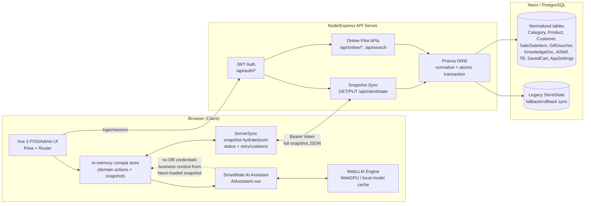
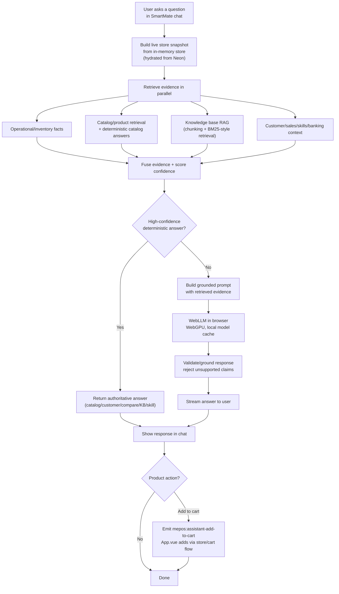

# MEPoS Online

MEPoS Online is a Vue + Express + PostgreSQL (Neon) point-of-sale application. The full store UI (POS, admin, and SmartMate AI assistant) runs in the browser, while Neon/PostgreSQL is the authoritative source for business data through the server API.

## Tech Stack

### Frontend
- **Vue 3** + **TypeScript** + **Vite** (multi-entry build)
- **Pinia** for app/auth/browser-AI state
- **Vue Router** (hash routing) for login, POS home, and admin routes
- **Tailwind CSS 4** + `lucide-vue-next` icons + `vue-sonner` toasts
- **`@mlc-ai/web-llm`** for in-browser LLM inference (WebGPU, local model cache)

### Backend
- **Node.js** + **Express**
- **Prisma** ORM + **PostgreSQL/Neon** (`pg_trgm` used for search/migrations as configured)
- **JWT auth** (`Authorization: Bearer <token>`)
- **bcryptjs** for password hashing

### Deployment
- **Render** web service (`render.yaml`)
- Build: `npm ci --include=dev && npm run build && cd server && npm ci --include=dev && npm run build`
- Start: `cd server && npm start` (`prisma migrate deploy && node dist/server.js`)


## Tech Architecture



## App Structure & Entry Points

| Entry | Source | Purpose |
|---|---|---|
| `index.html` | `src/main.ts` | Main Vue app: login, POS shell, admin, AI assistant, server sync |
| `online.html` | `src/online.ts` | Standalone online/pilot register using `/api/online/*` and `/api/search` |

### Main App Bootstrap Flow
1. `src/main.ts` creates Vue app, installs Pinia + router, mounts `#root`.
2. `src/App.vue` renders router, toasts, and `AiAssistant`, then calls `initServerSync()` on mount.
3. `src/router/index.ts` guards auth routes, verifies token/session, waits for store `ready` before entering protected routes.
4. `src/utils/serverSync.ts` hydrates/pushes the full store snapshot via `/api/client/state`.
5. POS/admin screens read/write through the in-memory compat store (`src/store/useStore.ts`), which preserves domain action semantics and emits snapshot changes for sync.

## Data Flow (Neon Authoritative)

### Core principle
**Business data comes from Neon via server APIs.** The browser keeps runtime state in memory; it does not persist business data in `localStorage`/`indexedDB`. `sessionStorage` is only used for auth token and the standalone online pilot pending-checkout recovery.

### Main App Snapshot Sync: `/api/client/state`

#### Read / Hydrate
1. User logs in (`POST /api/auth/login`) and receives JWT.
2. `ServerSync.reload()` sends `GET /api/client/state` with bearer token.
3. Server reads normalized store data from Neon tables: `Category`, `Product`, `Customer`, `Sale`/`SaleItem`, `GiftVoucher`, `KnowledgeDoc`, `AiSkill`, `Till`, `SavedCart`, `AppSettings`.
4. If table data is unavailable/empty in expected shape, server falls back to legacy `StoreState` singleton row.
5. Client validates snapshot (`products` array required), applies it to store, marks store `ready`, sets sync status.
6. If server data is unavailable/invalid, client does **not** overwrite Neon with stale/empty browser state.

#### Write / Sync
1. Store snapshot-backed fields change.
2. `ServerSync` marks dirty and schedules a debounced save (coalesced).
3. On save, client sends `PUT /api/client/state` with full snapshot.
4. Server normalizes payload, then writes atomically in a Prisma transaction (replace/insert across tables, upsert `AppSettings`, sync legacy `StoreState` for rollback).
5. Server returns `{ ok: true, counts: ... }`.
6. Client marks clean only if no newer local edits occurred during in-flight save; concurrent edits are queued and retried.

#### Snapshot fields
`categories`, `products`, `customers`, `sales`, `vouchers`, `knowledge`, `skills`, `tills`, `activeTillId`, `savedCarts`, `settings`.

#### Sync behavior
- Debounced/coalesced saves
- In-flight queue (no dropped edits)
- Retry on failure/cold start
- Status exposed for UI: `idle/syncing/synced/offline/error`
- Auth-aware: pending dirty edits can be flushed on token change/logout path as designed
- Legacy whole-store endpoints `/api/state` and `/api/backup` return **409** in online mode

## AI Tech Stack & Flow (SmartMate)

SmartMate is an in-browser assistant. **Inference runs locally in the browser via WebLLM/WebGPU**; **business context comes from Neon-loaded store snapshot**.

### How SmartMate AI Works




### AI Components
- `src/components/AiAssistant.vue` - chat UI, streaming/status, stop/clear, add-to-cart action.
- `src/utils/browserLlm.ts` - WebLLM engine loading/caching, model selection, browser chat/stream.
- `src/store/browserAi.ts` - browser AI state/model lifecycle.
- `src/utils/ai.ts` - snapshot building, catalog retrieval, deterministic catalog/customer/compare answers, prompt helpers.
- `src/utils/pipeline.ts` - evidence retrieval/fusion/decision/validation pipeline.
- `src/utils/rag.ts` - knowledge tokenization/chunking/BM25-style retrieval.
- `src/utils/knowledgeAi.ts` - grounded KB answer composition/checks with citations/fallbacks.
- `src/utils/inventoryLanguage.ts` / `knowledgeFile.ts` / figures helpers - query normalization, parsing, operational facts.

### AI Runtime Flow
1. **User asks question** in `AiAssistant.vue`.
2. Assistant builds **live store snapshot** from current in-memory store (hydrated from Neon): products, categories, customers, sales, settings, knowledge, skills, banking context.
3. **Evidence retrieval** (`retrieveEvidence`) runs over:
   - operational/inventory answers
   - customer context/purchase history
   - catalog/product retrieval and deterministic catalog answers
   - knowledge base retrieval (RAG/BM25-style chunks)
   - skills/variance helpers
4. **Fusion/decision** (`fuseEvidence` / `decideAnswer`) picks best path:
   - deterministic/authoritative answer when confidence is high (catalog/customer/compare/skills/KB/policy cases)
   - otherwise prepare evidence prompt for LLM
5. **LLM path (when used)**:
   - `browserLlm.ts` loads selected WebLLM model in browser (first load downloads/caches; later loads from browser cache)
   - prompts are constrained by retrieved evidence/snapshot context
   - response streamed to UI
6. **KB-grounded path** can use `answerFromKnowledge` with checks; unsupported/failing answers fall back to concise evidence-based response.
7. **Validation/fallback**: unverified claims are rejected/fallbacked; assistant avoids inventing store facts.
8. **Action bridge**: product cards can emit add-to-cart event; `src/app/App.vue` handles `mepos:assistant-add-to-cart` and adds item through existing store/cart flow.

### AI Data Privacy / Boundaries
- Model inference is local in browser (WebGPU/WebLLM). No business DB credentials in client.
- Assistant answers are grounded in Neon-loaded snapshot data available to app state.
- Knowledge/skills/settings/catalog context comes from server-synced snapshot, not hardcoded seed business data.

## Online/Pilot Entry (`/online.html`)

The standalone pilot register is a separate Vue entry (`src/online.ts`) with its own lightweight UI and contracts:
- Auth: `/api/auth/login`
- Summary: `/api/online/summary`
- Search: `/api/search`
- Records: `/api/online/records`
- Directory: `/api/online/directory`
- Checkout: `/api/online/checkout`

It keeps pending checkout recovery in `sessionStorage` keyed by username and is intentionally separate from the main app’s full `/api/client/state` snapshot sync.

## Environment Variables

| Variable | Required | Purpose |
|---|---:|---|
| `DATABASE_URL` | yes | Neon pooled PostgreSQL URL (runtime) |
| `DIRECT_URL` | yes | Neon direct PostgreSQL URL (Prisma migrations/schema) |
| `JWT_SECRET` | yes | JWT signing secret (>= 32 chars) |
| `ADMIN_USERNAME` | bootstrap | Initial admin/staff username |
| `ADMIN_PASSWORD` | bootstrap | Initial password (>= 12 chars, <= 72 UTF-8 bytes) |
| `POS_MODE` | optional | `online` default behavior; `legacy` only for isolated compatibility testing |
| `CORS_ORIGIN` | optional | CORS origin config |
| `PORT` | optional | Server port (default 3000) |

## Local Development

Use Node 22 and PostgreSQL with required extensions available (Neon-compatible).

1. Create `server/.env` with required vars.
2. Install/build:

```sh
npm ci
npm run build
cd server
npm ci
npm run build
npm start
```

3. Open `http://localhost:3000`.

## Tests

Root tests:

```sh
npm test
```

Server integration flow (after building root and server):

```sh
bash server/tests/online-pilot.sh
```

Requires local Postgres tools: `initdb`, `pg_ctl`, `psql`, `curl`.

## Operational Notes

- `render.yaml` includes `NODE_VERSION=22.16.0`; keep Node version aligned.
- Large catalogs can make whole-store snapshot writes expensive; server uses extended transaction timeout for client-state writes.
- For Render deploy failures at startup, inspect logs: build success + `prisma migrate deploy` advisory-lock/P1002 usually indicates DB connection/lock issue, not frontend build regression.
